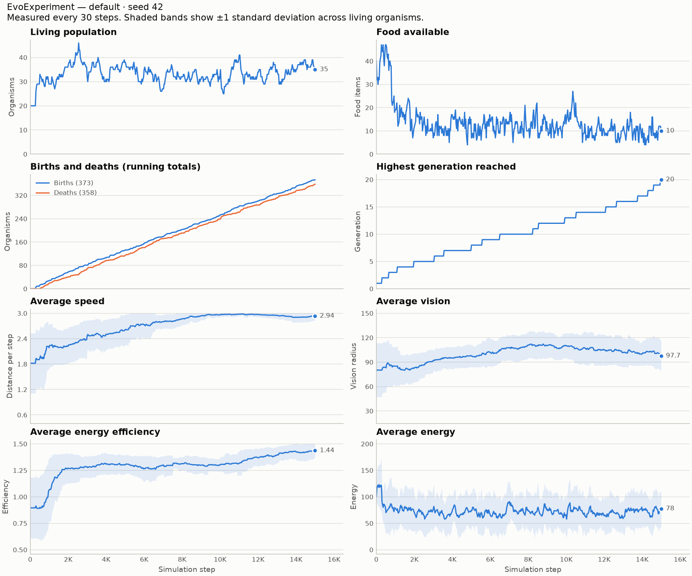

# EvoExperiment

EvoExperiment is an artificial life and evolution simulation written in Python.

The long-term goal is to simulate organisms that move around an environment, find food,
use energy, reproduce, inherit traits, and mutate over generations. Users will be able to
change environmental conditions and run experiments to see how populations evolve.

> **Status:** Early development. Organisms move, search for food, eat, use energy, reproduce,
> pass on their traits with small mutations, and die. Populations evolve over generations.

## Features (so far)

- A working ecosystem: organisms see food, move toward it, eat it, and starve without it
- Reproduction with inheritance and mutation, so trait averages change over generations
- Adjustable experiment settings (food, energy costs, mutation, population) from the command line
- Six ready-made experiments, and a headless mode that prints results without opening a window
- Repeat any run exactly (same seed and settings), or reset with a new random seed
- Statistics recorded every 30 steps, with Matplotlib charts of population and average traits
- A live chart window that updates while the simulation keeps running smoothly
- Data saved locally as CSV files (open them in any spreadsheet) and charts saved as images
- Pygame visuals for organisms and food, with pause, fast-forward, vision circles, and restart
- A `Simulation` class kept separate from the graphics code, so it can be tested without a window
- An `Organism` class with a unique ID, position, energy, age, alive/dead status, and three traits
- Validation that rejects invalid trait values instead of letting them break the simulation
- A configurable random seed, so experiments can be reproduced exactly
- Automated tests with pytest

## Project Structure

```
EvoExperiment/
├── src/
│   └── evoexperiment/
│       ├── __init__.py      # Package marker and version
│       ├── main.py          # Window, keyboard input, and the main loop
│       ├── cli.py           # Command-line options and headless runs (no Pygame)
│       ├── experiment.py    # ExperimentConfig, presets, and validation (no Pygame)
│       ├── renderer.py      # Pygame drawing functions (reads the simulation, never changes it)
│       ├── stats.py         # Measurements, history, and CSV files (no Pygame or Matplotlib)
│       ├── charts.py        # Matplotlib charts; also runs on its own to chart a CSV file
│       ├── chart_link.py    # Opens the chart window as a separate program and feeds it data
│       ├── settings.py      # All tunable numbers: window, traits, food, energy costs
│       ├── organism.py      # The Organism class and its movement (no Pygame)
│       ├── food.py          # The Food class (no Pygame)
│       ├── genetics.py      # Inheritance and mutation rules (no Pygame)
│       └── simulation.py    # The ecosystem rules and the step() method (no Pygame)
├── tests/
│   ├── test_organism.py     # Organism creation, traits, energy, aging, movement, boundaries
│   ├── test_ecosystem.py    # Eating, energy costs, death, boundaries, reproducibility
│   ├── test_reproduction.py # Reproduction, inheritance, mutation, IDs, generations, population cap
│   ├── test_experiment.py   # Experiment settings, validation, reset, repeatability, command line
│   ├── test_stats.py        # Statistics calculations, history tracking, CSV files, empty populations
│   ├── test_charts.py       # Chart labels, extinct populations, saved images, live data updates
│   └── test_simulation.py   # Simulation setup and seeds
├── docs/images/             # Example chart used in this README
├── pytest.ini               # Tells pytest where to find the code
├── requirements.txt
├── .gitignore
└── README.md
```

## Installation

You need Python 3.10 or newer.

```bash
# 1. Go to the project folder
cd EvoExperiment

# 2. Create and activate a virtual environment
python3 -m venv .venv
source .venv/bin/activate        # Windows: .venv\Scripts\activate

# 3. Install the dependencies (Pygame, Matplotlib, pytest)
pip install -r requirements.txt
```

The commands below assume the virtual environment is active. If `python` isn't found, use
`python3` instead.

## Running the App

Run this from the project folder:

```bash
# macOS / Linux
PYTHONPATH=src python3 -m evoexperiment.main

# Windows (PowerShell)
$env:PYTHONPATH="src"; python -m evoexperiment.main
```

To pick an experiment or change settings, add options (see [Experiments](#experiments)):

```bash
PYTHONPATH=src python3 -m evoexperiment.main --experiment scarce_food --seed 7
PYTHONPATH=src python3 -m evoexperiment.main --help    # list every option
```

### Controls

| Key   | Action                                                  |
|-------|---------------------------------------------------------|
| Space | Pause or resume                                         |
| F     | Fast-forward (20 steps per frame) on or off             |
| V     | Show or hide each organism's vision range               |
| R     | Repeat the run: same seed and settings, plays out exactly the same |
| N     | New run: same settings, new random seed                 |
| 1–6   | Switch experiment (keeps the current seed): 1 default, 2 scarce food, 3 abundant food, 4 high mutation, 5 no mutation, 6 high energy cost |
| C     | Open the live chart window (see [Statistics and Charts](#statistics-and-charts)) |
| S     | Save the data so far (CSV) and a chart image (PNG) to the `output/` folder |
| Esc   | Quit                                                    |

Every time a run starts, its full settings (including the seed) are printed in the terminal,
so you can always repeat it later.

### What you'll see

- **Green dots** are food.
- **Circles** are organisms. The short line shows which way each one is heading.
- Organism color shows energy: **blue** = full, **red** = nearly starving.
- The text in the top-left shows the experiment name, seed, step number, population, food, births, deaths,
  the highest generation reached, and the **average of each trait** next to its starting value.

See [How to Observe Evolution](#how-to-observe-evolution) for what to look for.

## Running the Tests

Run this from the project folder:

```bash
python3 -m pytest
```

Add `-v` to see each test's name.

## Organisms

Each organism (`src/evoexperiment/organism.py`) has:

| Attribute           | Meaning                                                   |
|---------------------|-----------------------------------------------------------|
| `id`                | Unique integer, given out in order by the simulation      |
| `x`, `y`            | Position in the world                                     |
| `energy`            | Starts at 100, capped at `max_energy` (200)               |
| `speed`             | Trait: distance moved per step                            |
| `vision`            | Trait: how far the organism can see                       |
| `energy_efficiency` | Trait: higher values make actions cost less energy        |
| `age`               | Steps lived so far                                        |
| `is_alive`          | `False` once the organism dies                            |
| `generation`        | 1 for the starting population, parent's generation + 1 for offspring |
| `parent_id`         | ID of the parent, or `None` for the starting population   |
| `offspring_count`   | How many offspring it has had                             |

What an organism can do:

- `gain_energy(amount)` adds energy, up to `max_energy`.
- `use_energy(amount)` spends `amount / energy_efficiency` energy. With an efficiency of 1.25,
  using 50 costs only 40. The organism dies when its energy reaches 0.
- `grow_older()` adds 1 to its age. The organism dies when it reaches `max_age` (3000).
- `move_towards(x, y)` moves up to `speed` units toward a point.
- `move_forward()` moves `speed` units in the direction it is facing (`heading`).
- `stay_inside(width, height)` keeps it inside the world, bouncing it off the edges.
- A dead organism can't gain energy, spend energy, or age.

### Trait ranges

Random organisms get trait values from these ranges, set in `settings.py`:

| Trait               | Minimum | Maximum |
|---------------------|---------|---------|
| `speed`             | 0.5     | 3.0     |
| `vision`            | 20.0    | 150.0   |
| `energy_efficiency` | 0.5     | 1.5     |

To try different ranges in one experiment without editing `settings.py`, pass your own ranges
to the simulation:

```python
ranges = {"speed": (2.0, 2.5), "vision": (10.0, 11.0), "energy_efficiency": (1.0, 1.1)}
simulation = Simulation(seed=3, population_size=20, trait_ranges=ranges)
```

### Validation

Invalid values raise an error right away instead of quietly causing problems later. This includes:

- a trait outside its range
- a value that isn't a number, or is NaN or infinite
- energy that is 0 or below, or above `max_energy`
- a negative age or ID
- a trait range whose minimum is larger than its maximum

### Creating organisms with exact traits

For tests or hand-built experiments, you can set every value yourself:

```python
from evoexperiment.organism import Organism

org = Organism(organism_id=1, x=10, y=20, speed=1.0, vision=50.0, energy_efficiency=1.0)
org.use_energy(30)
print(org)  # Organism(id=1, gen=1, pos=(10.0, 20.0), energy=70.0, age=0, ...)
```

## The Ecosystem

`Simulation.step()` moves the world forward by one time step. The app calls it once per frame.
Each step always runs in this order:

1. **Food may appear.** There is a `FOOD_SPAWN_CHANCE` chance that one new piece of food
   appears at a random spot, unless there are already `MAX_FOOD` pieces.
2. **Each living organism, in ID order:**
   1. Looks for the nearest food within its `vision`. It moves toward that food, or wanders
      in a slightly random direction if it sees none.
   2. Bounces off the edge if it moved outside the world.
   3. Pays energy: `(BASE_ENERGY_COST + distance_moved * MOVE_ENERGY_COST) / energy_efficiency`.
      Faster organisms reach food sooner but pay more to move.
   4. If it is still alive and within `EAT_DISTANCE` of food, eats it, gains `FOOD_ENERGY`,
      and the food is removed.
   5. Grows one step older.
   6. Reproduces, if it meets every requirement (see [Reproduction](#reproduction)).
      Newborns join the end of the list and start acting on the next step.
3. **Dead organisms are removed** (from starvation or reaching `max_age`).

All of these numbers are in `settings.py`, and you can also pass them to `Simulation` for a single
experiment:

```python
from evoexperiment.simulation import Simulation

scarce = Simulation(seed=7, food_spawn_chance=0.05, initial_food_count=10)
for _ in range(1000):
    scarce.step()
print(scarce.get_population_count(), "organisms survived")
```

The ecosystem rules live in `simulation.py`, `organism.py`, and `food.py`. `renderer.py` only
draws, so all the rules can be tested without opening a window.

## Reproduction

An organism has one offspring when **all** of these are true:

| Requirement                          | Setting                         | Default |
|--------------------------------------|---------------------------------|---------|
| Energy is at least                   | `REPRODUCTION_ENERGY_THRESHOLD` | 150     |
| Age is at least                      | `MIN_REPRODUCTION_AGE`          | 300     |
| Steps since its last offspring       | `REPRODUCTION_COOLDOWN`         | 200     |
| Living population is below           | `MAX_POPULATION`                | 150     |

When it reproduces:

- The parent loses `REPRODUCTION_ENERGY_COST` (80) energy. Energy efficiency does not reduce
  this cost. The threshold must be higher than the cost, so a parent can never reproduce itself
  to death.
- The offspring starts with `OFFSPRING_ENERGY` (60) energy, appears near the parent, gets the
  next unused ID, and is one generation higher than its parent.
- The offspring inherits the parent's traits, with possible mutations (below).

This is **asexual** reproduction: each offspring has a single parent, like bacteria splitting.

### Inheritance and mutation

The rules are in `src/evoexperiment/genetics.py`. For each trait, the offspring:

1. **Inherits** the parent's exact value.
2. **May mutate:** with chance `MUTATION_PROBABILITY` (default 0.2), a random amount is added.
   The amount comes from a bell curve centered on zero, so small changes are common and large
   ones are rare. `MUTATION_STRENGTH` (default 0.1) sets the typical size as a fraction of the
   trait's range. For speed (range 0.5 to 3.0), most mutations are smaller than 0.25.
3. **Is clamped** to the trait's allowed range, so mutation can never produce an invalid value.

Every setting above can also be passed to `Simulation` for a single experiment:

```python
from evoexperiment.simulation import Simulation

# Faster, bigger mutations and a smaller population limit.
sim = Simulation(seed=5, mutation_probability=0.5, mutation_strength=0.2, max_population=60)
```

## Evolution in This Model

### Natural selection

Nothing in the code tells organisms to get faster or more efficient. That change emerges from
three simple facts:

1. **Variation:** organisms have different trait values.
2. **Inheritance:** offspring get their parent's traits (plus small mutations).
3. **Selection:** food is limited, so some organisms gather enough energy to reproduce and others
   starve first.

An organism that reaches food sooner (higher speed), spots it from farther away (higher vision),
or wastes less energy (higher efficiency) is more likely to reach the reproduction threshold.
Its offspring inherit those traits, so over many generations the population's averages shift.

### Mutation

Without mutation, the population could only lose variety. The best starting organisms would take
over, and no new trait values would ever appear. Mutation adds a steady supply of new variation,
some better and some worse, for selection to act on. Try `mutation_probability=0` and compare.

### How to observe evolution

1. Run the app: `PYTHONPATH=src python3 -m evoexperiment.main`
2. Press **F** to fast-forward. Evolution takes thousands of steps.
3. Watch the **Avg speed / vision / efficiency** lines in the top-left. Each shows the current
   average next to the starting average.
4. Watch **Highest generation** climb as new generations are born.

With the default settings (seed 42), by around step 12,000:

| Trait               | Start | ~Step 12,000 |
|---------------------|-------|--------------|
| Speed               | 1.82  | 2.97         |
| Vision              | 80.2  | 105          |
| Energy efficiency   | 0.90  | 1.37         |

The population settles at around 30–40 organisms. That number is set by how much food appears,
not by `MAX_POPULATION`. Seeds 1, 7, and 2024 show the same pattern: speed and efficiency rise
toward the top of their ranges.

To see how the environment changes evolution, try the [Experiments](#experiments) below.

### Limitations of this simplified model

This is a teaching model, not a realistic one. Some important simplifications:

- **Few trade-offs.** Higher efficiency has no downside, and vision costs nothing, so those traits
  simply rise toward their maximum. In nature, most advantages come with a cost. Speed has only a
  small cost: movement is charged per unit of distance, so a fast organism pays the same as a slow
  one to reach the same food. It only pays extra while wandering, because it covers more ground
  each step. That's why even a high `--move-energy-cost` doesn't make organisms evolve to be slower.
- **Hard trait limits.** Traits can't evolve past the ranges in `settings.py`, so populations
  often pile up at the upper limit instead of finding a natural balance.
- **Asexual reproduction only.** There is one parent and no mixing of traits between two
  organisms, which is an important source of variation in real populations.
- **Traits are inherited directly.** There are no genes, DNA, dominant or recessive traits, or
  links between traits.
- **A simple environment.** There is one type of food, spread evenly at random. There are no
  predators, seasons, terrain, disease, or competition beyond racing to the same food.
- **Simple behavior.** Organisms always head for the nearest food they can see, and nothing
  about their behavior evolves.
- **Small populations.** With only about 35 organisms, random luck (genetic drift) can matter as
  much as selection. Different seeds can give somewhat different results, so compare several
  seeds before drawing conclusions.

## Experiments

Experiment settings live in `src/evoexperiment/experiment.py`, separate from the simulation
rules. An `ExperimentConfig` holds the settings below, checks that they are valid, and builds a
`Simulation` from them. Any setting you don't change uses its default from `settings.py`.

### Settings

| Setting                | Command-line option        | Default | Allowed values | What it does |
|------------------------|----------------------------|---------|----------------|--------------|
| `seed`                 | `--seed` / `--random-seed` | 42      | whole number ≥ 0 | Controls every random choice. Same seed + same settings = same run. |
| `population_size`      | `--population`             | 20      | whole number ≥ 1 | How many organisms the experiment starts with. |
| `max_population`       | `--max-population`         | 150     | whole number ≥ `population_size` | Organisms can't reproduce while this many are alive. |
| `initial_food_count`   | `--initial-food`           | 40      | whole number ≥ 0 | Food placed at the start. |
| `max_food`             | `--max-food`               | 80      | whole number ≥ 0 | No new food appears while this much exists. |
| `food_spawn_chance`    | `--food-spawn-chance`      | 0.3     | 0 to 1         | **Food spawn rate:** chance that one new food appears each step (0.3 ≈ 18 per second). |
| `food_energy`          | `--food-energy`            | 30      | > 0            | Energy an organism gains from one food. |
| `base_energy_cost`     | `--base-energy-cost`       | 0.1     | ≥ 0            | **Energy consumption:** energy used every step just to stay alive. |
| `move_energy_cost`     | `--move-energy-cost`       | 0.08    | ≥ 0            | **Energy consumption:** extra energy used per unit of distance moved. |
| `mutation_probability` | `--mutation-probability`   | 0.2     | 0 to 1         | Chance that each trait mutates in a newborn. |
| `mutation_strength`    | `--mutation-strength`      | 0.1     | ≥ 0            | Typical size of a mutation, as a fraction of the trait's range. |

Both energy costs are divided by each organism's energy efficiency. Invalid values are rejected
with a message listing every problem, for example:

```
error: Invalid experiment settings:
  - food_spawn_chance must be a number from 0 to 1, got 2.0
```

### Ready-made experiments

| Key | `--experiment`     | What it changes |
|-----|--------------------|-----------------|
| 1   | `default`          | Nothing. All settings come from `settings.py`. |
| 2   | `scarce_food`      | Food appears 0.12 per step (instead of 0.3), with at most 30 at once. |
| 3   | `abundant_food`    | Food appears every step, with up to 150 at once. |
| 4   | `high_mutation`    | Mutation probability 0.8 and strength 0.3. |
| 5   | `no_mutation`      | Mutation probability 0. |
| 6   | `high_energy_cost` | Base energy cost 0.25 per step (instead of 0.1). |

You can start from a preset and change individual settings:

```bash
PYTHONPATH=src python3 -m evoexperiment.main --experiment scarce_food --food-energy 50
```

### Suggested experiments

Each experiment below compares one setting against the default. The **headless** commands run
without a window and print the settings and results, which makes comparing runs quick. The
results below are from 15,000 steps with seeds 1, 42, and 7.

**1. Scarce food: does hunger favor better senses?**

```bash
PYTHONPATH=src python3 -m evoexperiment.main --experiment default     --seed 1 --headless --steps 15000
PYTHONPATH=src python3 -m evoexperiment.main --experiment scarce_food --seed 1 --headless --steps 15000
```

With scarce food, the population drops from about 34 to 11–19, and average vision ends higher
(104–125 instead of 98–111). When food is rare, seeing it from farther away matters more.

**2. Abundant food: what happens when survival is easy?**

```bash
PYTHONPATH=src python3 -m evoexperiment.main --experiment abundant_food --seed 1 --headless --steps 15000
```

The population grows to 112–123, and average vision **falls** from about 80 to 59–69. With food
everywhere, long vision gives little advantage, so mutations that reduce it are no longer weeded
out. Selection only maintains a trait while that trait is useful.

**3. High mutation vs. no mutation: where does variation come from?**

```bash
PYTHONPATH=src python3 -m evoexperiment.main --experiment high_mutation --seed 1 --headless --steps 15000
PYTHONPATH=src python3 -m evoexperiment.main --experiment no_mutation   --seed 1 --headless --steps 15000
```

With no mutation, traits can never go beyond the best starting organism. Average speed stalls at
2.4–2.75, compared with about 2.95 by default. With high mutation, newborns differ more from
their parents. Vision climbs higher (110–126), but more offspring are also born with worse traits.

**4. High energy cost: does a harsher world reward efficiency?**

```bash
PYTHONPATH=src python3 -m evoexperiment.main --experiment high_energy_cost --seed 1 --headless --steps 15000
```

The population settles lower (23–26), and energy efficiency reaches its maximum (1.47–1.50) on
every seed.

**Tips for fair comparisons**

- Change **one setting at a time** and keep the seed the same.
- Then repeat with a few different seeds (`--seed 1`, `--seed 2`, ...). With small populations,
  luck plays a big role, so a pattern only counts if it shows up across several seeds.
- To watch an experiment instead, drop `--headless` and press **F** to fast-forward.

### Repeating and resetting experiments

- **Repeat exactly:** run the same command again, or press **R** in the app. The same seed and
  settings always give the same result at every step.
- **New random seed:** press **N** in the app, or use `--random-seed`. The chosen seed is printed
  in the terminal and shown on screen, so that run can be repeated later with `--seed`.

You can do the same in Python:

```python
from evoexperiment.experiment import ExperimentConfig, make_preset, run_experiment

config = ExperimentConfig(seed=7, food_spawn_chance=0.1, mutation_probability=0.5)
print(run_experiment(config, steps=5000))    # same result every time

scarce = make_preset("scarce_food", seed=7)
other_seed = scarce.with_new_seed()          # same settings, new seed
richer = scarce.copy_with(food_energy=50)    # change one setting
```

## Statistics and Charts



### What is measured

Every **30 simulation steps** (set by `STATS_INTERVAL` in `settings.py`), `stats.py` records one
row of measurements:

| Measurement            | Meaning |
|------------------------|---------|
| `step`                 | Simulation step when the measurement was taken |
| `living`               | Organisms alive right now (the current population) |
| `total_births`         | Offspring born since the start |
| `total_deaths`         | Organisms that have died since the start |
| `food`                 | Food items currently in the world |
| `highest_generation`   | Highest generation any organism has reached |
| `avg_speed`, `std_speed` | Average speed of living organisms, and how spread out it is (standard deviation) |
| `avg_vision`, `std_vision` | Same for vision |
| `avg_energy_efficiency`, `std_energy_efficiency` | Same for energy efficiency |
| `avg_energy`, `std_energy` | Same for current energy |

Some details:

- **Measurements follow simulation steps, not screen frames.** Pausing, fast-forwarding, or a slow
  computer never adds duplicate rows or skips any. The same seed and settings always produce the
  same history.
- **Recording only reads the world,** so it never changes how a run plays out. A test checks this.
- **When nobody is alive,** the averages are left empty (`None` in Python, a blank cell in CSV)
  instead of crashing or pretending to be 0. The charts show a gap, and the population chart is
  labeled with the step at which the population died out.

### Viewing the charts

| How | What happens |
|-----|--------------|
| Press **C** in the app | Opens a live chart window that refreshes every 2 seconds |
| Press **S** in the app | Saves `output/<experiment>_seed<seed>_step<step>.csv` and a matching `.png` |
| `--headless --save-data run.csv --save-charts run.png` | Runs without a window, then saves both |
| `python -m evoexperiment.charts run.csv` | Opens a saved CSV file in a chart window |
| `python -m evoexperiment.charts run.csv --save run.png` | Turns a saved CSV file into an image |

For example:

```bash
PYTHONPATH=src python -m evoexperiment.main --experiment scarce_food --seed 1 \
    --headless --steps 15000 --save-data output/scarce.csv --save-charts output/scarce.png
```

**Why the simulation stays smooth.** The chart window runs as a separate program. About once a
second, the app writes its measurements to `output/live_history.csv`, and only when there is
something new. The chart window re-reads that file every 2 seconds. Redrawing eight charts takes
about half a second, but that happens in the other program, so the simulation never waits for it.
You can zoom and pan in the chart window. A zoom resets when new data arrives, so pause the
simulation (Space) to study a chart closely. Pressing R, N, or 1–6 starts a new history, and the
chart window switches to it automatically.

All data stays on your computer in the `output/` folder, which is excluded from git.

### How to read the charts

The figure has eight panels that share the same horizontal axis (simulation steps). Each measure
has its own panel and y-axis, because the measures use different units. The newest value is
written beside the end of each line.

On the four **trait panels**, the dark line is the average across living organisms. The
**shaded band** spans one standard deviation above and below it, which shows how much individuals
differ. The y-axis covers the trait's full allowed range, so you can see how close the population
is to its limits.

**Example: the default experiment, seed 42** (the chart above):

- **Living population** rises from 20 to about 35 within the first 1,000 steps, then fluctuates
  between about 25 and 45. That level is the **carrying capacity**: the number of organisms the
  food supply can support. It is far below `max_population` (150), so food, not the cap, limits
  the population.
- **Food available** falls from 40 to about 10 and stays low. Food is eaten almost as fast as it
  appears, which confirms the population is food-limited. If this line climbs back up while the
  population falls, organisms are dying for some reason other than hunger (for example, old age).
- **Births and deaths** rise as two nearly parallel lines. The gap between them is always the
  population minus the 20 starting organisms, so parallel lines mean a stable population. The
  slope shows **turnover**: here about 25 births per 1,000 steps.
- **Highest generation** climbs in steps, reaching 20 by step 15,000, roughly one new generation
  every 750 steps.
- **Average speed** climbs from 1.82 to about 2.9 and levels off against the maximum of 3.0, while
  the band narrows. This is **directional selection**: faster organisms leave more offspring. The
  narrowing band shows that variation is being used up, because almost everyone is now fast.
- **Average energy efficiency** jumps from 0.90 to about 1.27 in the first 2,000 steps, then
  creeps up to 1.44. The early jump is mostly the least efficient starting organisms starving
  before they could reproduce. The slow climb afterward is mutation and selection working
  generation by generation.
- **Average vision** rises from about 80 to 110, then drifts back toward 100 with a wide band.
  Selection on vision is weaker than on speed, so random drift has more effect.
- **Average energy** drops from 100 to about 70–80 and stays there, well below the reproduction
  threshold of 150. Most organisms are hungry most of the time, and only the few that reach 150
  reproduce. The wide band means energy differs a lot between individuals.

**Comparing experiments.** Save charts for two experiments with the same seed and compare
the same panel:

- In `abundant_food`, the population panel levels off near 115, and the **vision** line falls
  instead of rising. Once food is everywhere, good eyesight stops paying off.
- In `scarce_food`, the population levels off at about 11–19, and vision ends higher than in the
  default run. Surprisingly, the food line stays around 10, about the same as the default run,
  even though food appears less than half as often. The population shrinks until the survivors
  eat food about as fast as it appears. The difference shows up in the population panel, not the
  food panel.
- In `no_mutation`, the speed band shrinks until it disappears (a standard deviation of exactly 0
  on seeds 42 and 7). Every living organism is then descended from the same starting ancestor. The
  line flattens below 3.0 (at 2.4–2.75), because without new variation the population can only
  become as fast as its best starting organism.
- If a population dies out, every line stops at that step, and the population panel says
  "Died out at step …". A food line climbing back toward `max_food` afterward confirms nothing is
  left to eat it.

**Reading the charts carefully**

- **The band is not a margin of error.** It shows how much individual organisms differ, not how
  certain the average is.
- **One run is one sample.** With about 35 organisms, chance plays a big role. Before concluding
  that a setting causes an effect, check that the pattern repeats across several seeds.
- **The first measurements are noisy.** The starting population is random, and the first few
  hundred steps are mostly the starting organisms adjusting to the environment.
- **A flat line at a trait's limit** doesn't mean evolution stopped. It means the trait hit the
  range in `settings.py` (see [Limitations](#limitations-of-this-simplified-model)).

## Reproducible Experiments

The `Simulation` class takes a `seed`. Every random choice (starting positions, traits, food
locations, wandering, offspring placement, and mutations) comes from the simulation's own random
number generator. So the same
seed and settings always give the same run, step for step:

```python
from evoexperiment.simulation import Simulation

a = Simulation(seed=123, population_size=15)
b = Simulation(seed=123, population_size=15)
assert a.initial_positions == b.initial_positions
```

The app's default seed and population size are set in `src/evoexperiment/settings.py`.

## Tech Stack

- [Python](https://www.python.org/)
- [Pygame](https://www.pygame.org/): graphics and the window
- [Matplotlib](https://matplotlib.org/): charts
- [pytest](https://docs.pytest.org/): automated tests

## Roadmap

- [x] Project foundation
- [x] Organisms with traits, energy, aging, and death
- [x] Organisms that move around the environment
- [x] Food and energy
- [x] Reproduction and inherited traits
- [x] Mutation over generations
- [x] Adjustable environmental conditions for experiments
- [x] Population charts with Matplotlib
